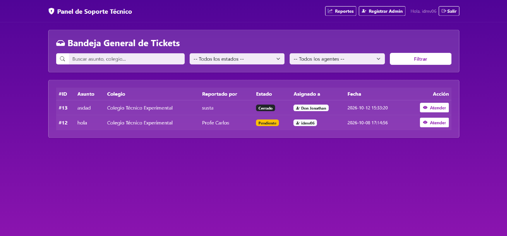
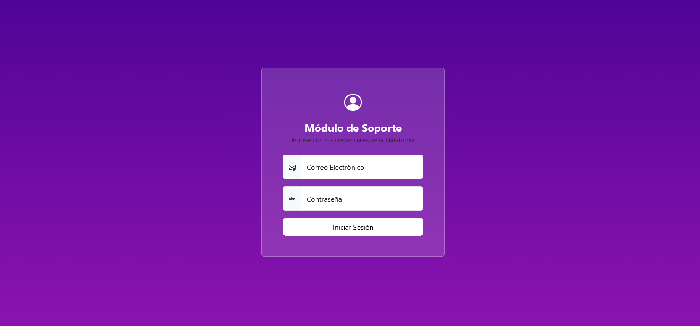
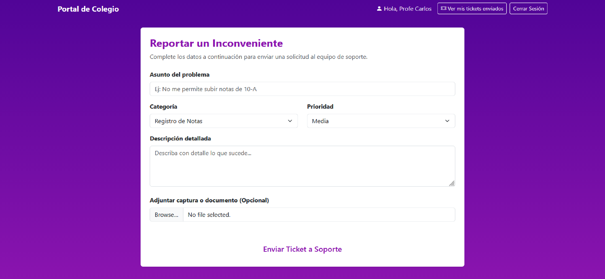
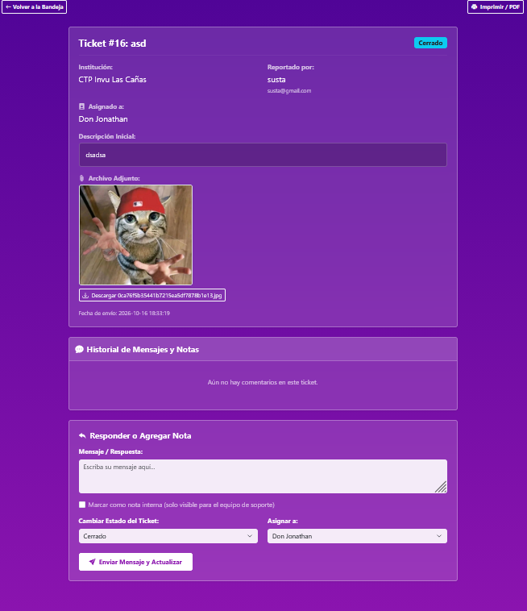
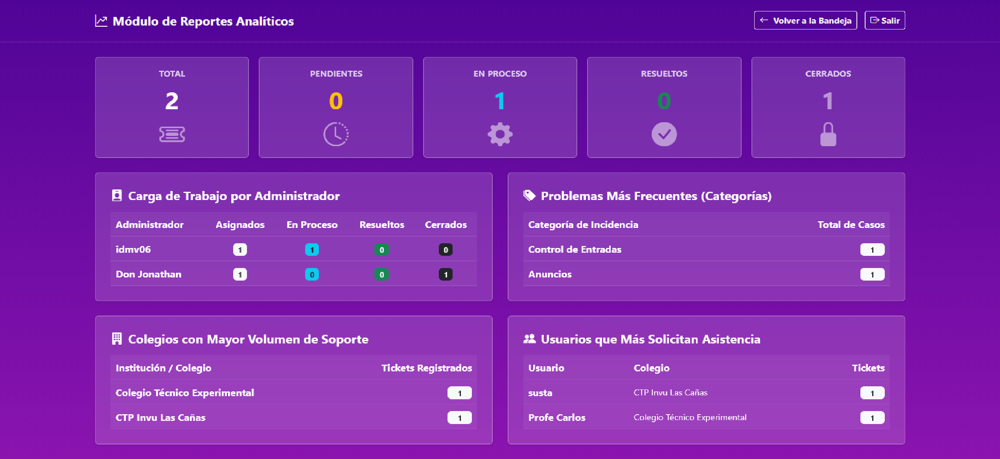
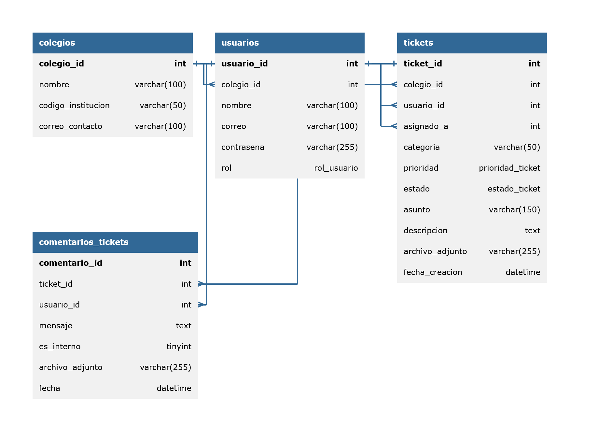

# 🎫 Sistema de Tickets

     

  

## 🌟 Características

- Contraseñas protegidas mediante hashing con bcrypt.
- Protección contra inyecciones SQL mediante consultas preparadas.
- Protección contra XSS mediante escape de salida.
- Validación de archivos adjuntos por tipo MIME y tamaño.
- Interfaz personalizada con estética Glassmorphism.
- Roles diferenciados para profesores, personal administrativo y soporte técnico.
- Creación de tickets con archivos adjuntos.
- Sistema de comentarios públicos e internos (notas privadas para el equipo).
- Asignación y reasignación de agentes de soporte.
- Panel de administración con búsqueda por texto y filtros por estado y agente.
- Vista de impresión optimizada para guardar los tickets como PDF desde el navegador.
- Protección CSRF
- Login Timeouts para prevenir bruteforcing

## ℹ️ Descripción

Sistema web de gestión de tickets desarrollado como proyecto de práctica profesional. Su objetivo es facilitar la creación, organización y seguimiento de solicitudes de soporte técnico mediante una plataforma centralizada.

El proyecto integra herramientas de desarrollo web, gestión de bases de datos, control de acceso y medidas de seguridad para ofrecer una experiencia de uso organizada.

## ✍️ Autor

**Isaac Martínez**

Este es mi primer proyecto de desarrollo de una plataforma web, realizado como parte de mi práctica profesional. Representa una oportunidad para aplicar mis conocimientos de programación, bases de datos y desarrollo web en un proyecto práctico.

## 🚀 Uso

La plataforma permite gestionar tickets, es decir, solicitudes de asistencia técnica relacionadas con problemas específicos.

Según los permisos de cada rol, las personas usuarias pueden crear solicitudes, adjuntar archivos, consultar el estado de los tickets y participar en el seguimiento de su resolución.

El equipo de soporte puede gestionar las solicitudes, asignar responsables y utilizar comentarios internos para coordinar la atención.

## 📸 Capturas de Pantalla

<table>
  <tr>
    <td align="center" width="50%">
      <strong>Inicio de sesión</strong>  
      
    </td>
    <td align="center" width="50%">
      <strong>Crear un ticket</strong>  
      
    </td>
  </tr>
  <tr>
    <td align="center" width="50%">
      <strong>Detalle y seguimiento del ticket</strong>  
      
    </td>
    <td align="center" width="50%">
      <strong>Reportes y analíticas</strong>  
      
    </td>
  </tr>
</table>

## 🗄️ Modelo Entidad-Relación

  

## ⬇️ Instalación

### Requisitos previos

- PHP 8.x, con las extensiones necesarias para la aplicación.
- MySQL o MariaDB.
- Un servidor web compatible con PHP, como Apache.
- El archivo SQL incluido en el repositorio.

### Pasos de instalación

1. **Obtener el proyecto:** clonar el repositorio o descargar sus archivos.
2. **Configurar la base de datos:** crear una base de datos en MySQL o MariaDB e importar el archivo `.sql` incluido en el repositorio.
3. **Configurar la conexión:** ajustar el archivo de conexión con las credenciales correspondientes. Si se utilizan variables de entorno, configurarlas según el entorno de ejecución.
4. **Iniciar el servidor:** ejecutar la aplicación mediante un servidor compatible con PHP.
5. **Acceder al sistema:** abrir la dirección local o la URL del despliegue y navegar hasta la página de inicio de la aplicación.

> **Nota:** Los pasos exactos de configuración pueden variar según se ejecute el proyecto en un entorno local o en un servicio de alojamiento en la nube.

---

## 📝 Créditos y transparencia

- **Desarrollo:** proyecto realizado por Isaac Martínez como parte de mi práctica profesional.
- **Inteligencia artificial:** se utilizaron herramientas de IA como apoyo para resolver dudas, comprender conceptos, depurar código y mejorar la documentación. La IA fue una herramienta de asistencia durante el proceso de desarrollo, no un sustituto del aprendizaje ni de mi participación en el proyecto. **Hecho con apoyo de IA, pero no mediante vibe coding**
- **Plantilla del README:** documentación estructurada tomando como referencia la guía [*How to write a good README*, de Bane Sullivan](https://github.com/banesullivan/README), adaptada a las necesidades de este proyecto.
- **Mejora continua:** este proyecto forma parte de mi aprendizaje en desarrollo web y puede recibir mejoras, correcciones y nuevas funcionalidades.
